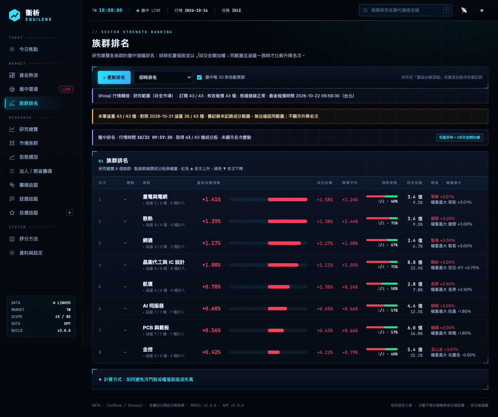

# EquiLens (衡析) · Taiwan stock trading dashboard

**A self-hosted Taiwan stock trading dashboard and research desk (tw-trading-dashboard).** EquiLens runs on your own computer: it ranks the companies you choose to
research, shows where money is flowing, watches the market during the session, recognizes chart patterns and
writes an after-market report with the AI model of your choice. You bring your own data sources and API keys;
nothing is sent to anyone else.

[繁體中文說明](README.zh-TW.md) · [Feature guides (zh-TW)](docs/features/README.md) · [Changelog (zh-TW)](docs/CHANGELOG.zh-TW.md) · [Architecture](docs/ARCHITECTURE.md) · [Day-trade monitoring (zh-TW)](docs/DAYTRADE.zh-TW.md)

> EquiLens is a research tool. Scores rank research, they are not trading signals, price targets or return
> predictions. Nothing here is investment advice.


<sub>All screenshots use synthetic sample data, not real market data. The interface is shown in Traditional Chinese; English is also available.</sub>

---

## What's inside

| Component | What it is | Default address |
|---|---|---|
| **EquiLens Nexus** (`EquiLens-Nexus/`) | The desktop app and the only data engine: research scores, sector heatmap, intraday radar, pattern scanner, AI report, settings | http://127.0.0.1:4330 |
| **EquiLens Pocket** (`EquiLens-Pocket/`) | Optional mobile web app (PWA) that reads from Nexus, protected by a password, reachable from your phone through a Cloudflare Tunnel; supports push notifications | http://127.0.0.1:4340 |

Both servers bind to `127.0.0.1` only. Your settings, research groups and cached market data live in each
component's `.local/` folder; API keys are encrypted by the operating system (see [Security](#security)).

### Features

- **Research overview** – a four-factor score (technical, institutional flows, topic evidence, industry trend) for every
  stock in *your* research groups, with transparent reasons, missing-data handling and an effective-weight disclosure.
- **Sector heatmap** – turnover-sized, change-colored treemap of the whole market (or of your research groups when the
  data source has no whole-market data), live during the session, with a per-minute **time machine** replay.
- **Intraday radar** – volume spikes, surges and plunges, price-limit touches, pattern entries and stop breaks for your
  watchlist and research groups, plus a live board with daily / 5-minute candles. **Custom alerts** let you set price,
  % change or projected-volume conditions on any stock; they are pushed to your phone when met (one-time or repeating). With a Fugle key the radar runs on a
  WebSocket live stream (watchlist first, up to your plan's limit) instead of periodic snapshots.
- **Day-trade monitoring** (Taiwan, FinMind + Fugle) – Watchlist alerts combine the previous 30 daily candles,
  completed 60-minute and 5-minute candles, same-slot historical volume and a continuous live five-level book window.
  Three long setups are accompanied by weakness and reference-stop alerts; risk alerts continue after the entry cutoff.
  Missing history, stale data or an incomplete feed pause confirmation. Each stock shows its evidence and readiness;
  v1/v2 after-close outcome statistics remain separate. See [the rules and limitations](docs/DAYTRADE.zh-TW.md).
  Each signal also records the state of its own index (TAIEX for listed stocks, TPEx for OTC stocks: change, 15-minute
  change, position against the intraday average) and the stock's relative strength; the review groups outcomes by
  tailwind / neutral / headwind and stronger / weaker than the market. This is recorded only — scores, thresholds and
  alerts are unchanged ([details, zh-TW](docs/features/daytrade-market.md)).
- **Group ranking** – your research groups ranked by turnover-weighted gain, with daily close records.
- **Pattern scanner** – 10 classic patterns over 90 sessions with conditional entry and stop levels.
- **AI after-market report** – written by Claude, OpenAI, Gemini or any OpenAI-compatible endpoint (including local
  models), with a short note on every watchlist stock and a downloadable 9:16 summary card.
- **Chip tracking** (Taiwan, FinMind Sponsor) – track chosen broker branches (each branch's market-wide trades after the
  close, streaks, push above a threshold) and rank stocks by the weekly change in 1,000-lot holders. **Warrant tracking**
  adds each tracked branch's call-warrant trades grouped by underlying (big-buy and consecutive-buy alerts; the issuer's
  own market making is excluded) and a call-warrant panel in the stock window ([details, zh-TW](docs/features/warrants.md)).
- **Market-specific modules** – for Taiwan with FinMind: broker branches, shareholding distribution, institutional
  and futures/options flows.
- **Interface languages** – Traditional Chinese and English.

### Screenshots

| | |
|---|---|
| **Sector heatmap**<br> | **Live board and intraday radar**<br> |
| **Intraday chart window**<br> | **Day-trade scanner**<br> |
| **Day-trade review by market regime**<br> | **Group ranking**<br> |
| **AI after-market report**<br> | **Broker-branch tracking**<br> |
| **Institutional and futures/options flows**<br> | **Stock diagnosis**<br> |
| **Pattern scanner**<br> | **Topic evidence**<br> |
| **Call-warrant panel**<br> | **Branch call-warrant trades**<br> |

**Mobile (EquiLens Pocket)**


## Markets and data sources

One EquiLens instance researches one market at a time. Trading hours (including lunch breaks), time zone, tick
sizes, price limits, up/down colors, volume units and symbol formats all come from the market profile. When you
switch markets, each market's groups, watchlist and records are stored separately and restored when you switch back.

Supported markets: **Taiwan, United States, Japan, Hong Kong, South Korea, United Kingdom, Germany, France, Canada,
Australia, Singapore, India.**

| Data source | Markets | Key | Provides |
|---|---|---|---|
| [TWSE / TPEx open data](https://openapi.twse.com.tw) | TW | none | stock list, trading calendar, daily bars, whole-market daily data, institutional flows (whole market by day), P/E, monthly revenue |
| [FinMind](https://finmindtrade.com) | TW | free / Sponsor | daily and adjusted bars, institutional flows, revenue, P/E, news, shareholding, futures, margin; **Sponsor** adds live snapshots, minute bars, whole-market data, broker branches and the pre-market day-trade list, suspensions and reference prices |
| [Fugle](https://developer.fugle.tw) | TW | free / paid | daily (adjusted) and minute bars; WebSocket live stream for the intraday radar and day-trade monitoring (subscriptions: Basic 5, Developer 300, Advanced 2,000 — full mode uses trades + 1-minute bars + order book, 3 per stock; otherwise aggregates, 1 per stock); paid plans add a whole-market live snapshot |
| [SinoPac Shioaji](docs/features/shioaji-bridge.md) (quote bridge) | TW | local bridge token (quote-only SinoPac key) | live stream for the intraday radar, live board, research-scope heatmap and custom alerts through the local `sj-quote-bridge` (aggregates only, up to 200 stocks); cannot place orders |
| [Twelve Data](https://twelvedata.com) | all 12 markets | free / paid | stock list, daily bars, live quotes, minute bars |
| [Alpha Vantage](https://www.alphavantage.co) | US, GB, CA, DE, IN | free / premium | daily bars, quotes, news sentiment, P/E, quarterly revenue |

Enable several sources and EquiLens picks a source per capability (in your order, or as you specify under
*Data & Settings → Data sources → Advanced*). Features a source can't support are hidden or fall back to your
research list's local data — the settings page shows exactly which features are available.

Shioaji intraday group ranking also reuses the existing subscription cache (up to 200 stocks), keeping the original low-turnover filter and square-root-turnover formula. Desktop and mobile show the provider, quote time, feed status and coverage. Rank changes are shown only when group membership, quoted symbols and rules are verifiably identical. Legacy closing files remain unchanged; closing capture and rebuilding retain their snapshot/replay/daily-data paths.

A live-stream source drives the intraday radar and day-trade monitoring. Shioaji also feeds the live board from the existing subscription cache, with actual quote times and connection status; snapshot errors are displayed separately. With Shioaji selected, the intraday heatmap reuses existing subscriptions (up to 200 stocks) and labels research scope, confirmed/planned subscriptions, quote coverage, quote time and connection status. It adds no subscriptions or upstream snapshot calls. Whole-market closing data, historical queries and snapshot-based time-machine recording remain unchanged. In Shioaji board mode, stocks outside the existing subscription list show an explicit unavailable state and no live price. Other providers retain their snapshot behavior; no additional subscriptions are created.

Free plans have tight quotas. EquiLens rate-limits every source, resumes interrupted updates and never assumes a higher
plan than the one detected when you saved the key.

## Requirements

- **Node.js 22 or newer** – https://nodejs.org
- Windows 10/11, macOS or Linux
- At least one data source that covers your market (TWSE/TPEx open data works for Taiwan without any key)
- Optional: an API key for an AI model; `cloudflared` for phone access

## Quick start

```bash
git clone https://github.com/wakin61043/tw-trading-dashboard.git
cd tw-trading-dashboard/EquiLens-Nexus
npm install --omit=dev
```

Start Nexus:

| Windows | macOS / Linux |
|---|---|
| double-click `EquiLens-Nexus\啟動衡析Nexus.cmd` (or `Start-Nexus.ps1`) | `./start.sh` |
| stop: `Stop-Nexus.ps1` | stop: `./stop.sh` |

Open http://127.0.0.1:4330. The first launch shows a **setup wizard**:

1. Interface language and the market to research
2. Data sources – tick the ones you want and paste their keys (each key is verified before it is saved)
3. AI model – service, key and model (optional; everything else works without it)
4. Research groups – create groups, load sample groups for your market, or import a settings file

Then press **Update** to download history for your research groups. Updates can be stopped and resumed.
Everything can be changed later under **Data & Settings**.

On Windows you can also double-click **安裝衡析.cmd** in the repository root: it checks Node.js, installs packages,
starts Nexus and opens the setup wizard (it also restores a `migration-data` folder exported from another computer).

### Phone access (optional)

```bash
cd EquiLens-Pocket
node scripts/set-password.mjs     # at least 10 characters
./start.sh                        # Windows: 啟動衡析手機版.cmd
```

`start.sh` starts Nexus if needed, starts Pocket and then opens the public address according to the **connection
mode** chosen under *Data & Settings → Remote access*. You decide the domain and the way traffic reaches your computer:

| Connection mode | What happens | You provide |
|---|---|---|
| Automatic (default) | Cloudflare fixed domain when `EquiLens-Pocket/.local/cloudflared.yml` exists, otherwise a temporary URL | – |
| Cloudflare temporary URL | a random `https://….trycloudflare.com` address (changes on restart) | `cloudflared` |
| Cloudflare fixed domain | your domain through a Cloudflare Named Tunnel | a domain on Cloudflare, `cloudflared.yml` |
| Self-managed | EquiLens starts no tunnel; you forward an HTTPS address to `http://127.0.0.1:4340` with ngrok, Tailscale Funnel, Caddy, Nginx… | any domain and HTTPS certificate |
| Off | Pocket only answers on this computer | – |

Enter your domain(s) under *Remote access*: only those hosts are accepted, and the main address is also the contact
for push notifications. See `EquiLens-Pocket/README.md` for step-by-step examples. Add Pocket to your home screen to
receive push notifications (iPhone: iOS 16.4+).

## Configuration

| Where | What |
|---|---|
| *Data & Settings* page | market, language, up/down colors, remote access (connection mode, domains, push contact, desktop remote access), data sources and keys, AI model, research groups, update schedule, score weights, radar and news push |
| `EquiLens-Nexus/.local/` | all Nexus data (`config.json`, groups, watchlist, cached prices, records) – never commit it |
| `EquiLens-Pocket/.local/` | password hash, sessions, push subscriptions, tunnel settings – never commit it |
| Settings file | *Data & Settings → Settings file* exports groups, watchlist and settings **without keys** for another computer |

Environment variables (optional): `PORT`, `EQUITY_DATA_DIR` (Nexus data folder), `MOBILE_DATA_DIR`, `NEXUS_URL`
(Pocket), and key overrides `FINMIND_API_TOKEN`, `FUGLE_API_KEY`, `TWELVEDATA_API_KEY`, `ALPHAVANTAGE_API_KEY`,
`ANTHROPIC_API_KEY`, `OPENAI_API_KEY`, `GEMINI_API_KEY`, `LLM_API_KEY`.

## Security

- Servers listen on `127.0.0.1` only; write APIs require a CSRF token and same-origin requests.
- API keys are stored with the operating system's protection: **Windows DPAPI**, **macOS Keychain**, or
  **Secret Service** on Linux (a file readable only by you as a fallback). The web pages never read keys back.
- Pocket uses a scrypt password hash, login rate limiting, HttpOnly/SameSite cookies, a strict CSP and a host
  allow-list built from the domains you enter. Client IPs and HTTPS are read only from the headers of the connection
  mode you chose (Cloudflare or your own proxy), so headers from other sources can't bypass the login limits.
- Remote access to the full desktop app requires Cloudflare Access (it can change keys and every setting), and Nexus
  verifies every request's Access JWT itself; configure it under *Data & Settings → Remote access*.
- Your data stays on your computer. The only outbound requests go to the data sources and AI service you configure,
  plus public news and calendar feeds used by *Today's Brief*.

## Development

```bash
cd EquiLens-Nexus && npm test        # library, server and framework tests
cd EquiLens-Pocket && npm test
node EquiLens-Nexus/tools/i18n-keys.mjs --missing en   # interface strings without an English translation
```

See [docs/ARCHITECTURE.md](docs/ARCHITECTURE.md) for how markets, data sources, AI providers and languages plug in.

## Disclaimer

Market data belongs to its providers; respect each provider's terms and plan limits. EquiLens is provided as is,
without warranty, and is not investment advice.
