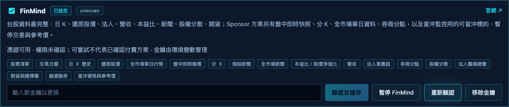

# FinMind 憑證與能力狀態

既有行情設定繼續使用；失效或主動停用的憑證不再送出資料請求。能力顯示與權限證據分開，未知權限不代表已確認付費方案，也不會把原本可嘗試的能力全部關閉。

## 在哪裡

電腦版「資料與設定」的 FinMind 卡片顯示憑證狀態、權限未確認與可重試時間。使用「暫停 FinMind」停止請求，使用原有「重新驗證」恢復。此操作不改來源偏好、不刪既有行情。

## 升級與狀態

首次升級不會額外呼叫驗證端點。有既有金鑰時標為「既有金鑰未重新驗證」，延續正常工作；既有 free 記錄封鎖的能力維持相容限制，明確重新驗證成功才解除。缺金鑰時不送出資料請求。損壞狀態檔、存在但內容為 null／陣列／非物件的狀態，或未完成的金鑰變更都會停用；只有檔案不存在才套用首次升級預設，需明確重驗才能恢復。

正常資料請求成功可確認該憑證被接受，但不推論付費等級。user_info 的數字 level、名稱或額度均不作方案證據；權限維持 unknown。沒有新增方案設定介面。

401 或明確 token 失效會持久停用所有 FinMind 請求；一般 403 與明確方案拒絕只暫停該資料操作 30 分鐘。402／429 或 quota 回應暫停 FinMind，採合法 Retry-After（最多 24 小時），沒有時預設 30 分鐘。新聞與監控原有暫停時間仍保留，顯示較晚的可重試時間。

明確儲存資料來源設定可重試單項資料拒絕，與原本新聞重試行為相容；此動作與金鑰保存／移除共用序列化，等待中的儲存不會被來源重試打斷；不解除憑證停用或全域 quota。切換市場、重啟與匯入設定也不會解除它們。其他資料源不受 FinMind 狀態影響。

## 金鑰變更

候選金鑰先驗證，成功後才保存。保存不確定時停用，不假稱恢復成功。變更或停用增加憑證世代；排隊中的舊請求不再送出，在途舊結果被捨棄。已經送到網路的請求無法撤回。

環境變數 FINMIND_API_TOKEN 優先於儲存金鑰；此情況卡片禁止假更換，需先調整啟動環境。暫停仍有效；移除儲存金鑰不代表環境變數也被移除。

## 資料來源與請求量

日資料維持原佇列及請求間隔，間隔以實際送出請求時間計算，讀取金鑰的等待不會縮短下一次間隔。快照保留獨立 20 秒逾時通道，不排入權證長查詢；權證 120／180 秒逾時原樣透傳。新增狀態讀取不發網路請求；重新驗證只由使用者操作觸發。

狀態存於 `.local/finmind-access.json`，不含金鑰、token hash 或原始回應。設定匯出入不包含此安全狀態。本功能不改還原價評分、法人備援、歷史補資料、快取格式或其他 provider。

## 驗證與限制

使用合成憑證及 mock 回應驗證狀態、世代、取消、權限拒絕與 API；完整離線及瀏覽器結果另隨變更交付。沒有驗證真帳戶方案或盤中券商端到端，也不宣稱付費能力已獲官方確認。

相關檔案：`lib/finmind-access.mjs`、`lib/finmind-lifecycle.mjs`、`lib/providers/finmind.mjs`、`public/setup.js`。
