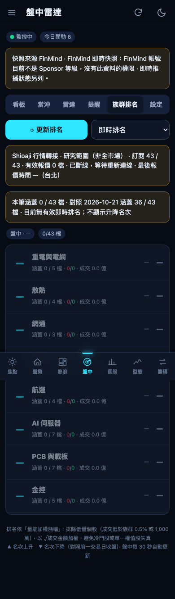

# 族群排名

把研究總覽各族群依量能加權漲幅排名。選用 Shioaji 時，盤中排名與看板共用既有最多 200 檔訂閱，不新增行情連線、訂閱或 REST 請求。原公式及收盤流程保留，只看行情、不下單。其他來源保留快照查詢。

## 在哪裡

- 電腦版：左側選單「族群排名」。
- 手機版：「盤中 → 族群排名」。
- 即時看板的族群切換列也使用同一套排名公式。

## 資料來源與狀態

Shioaji 排名只用**當日、本次連線、目前已訂閱**的有效報價，必須有價格、漲跌金額與正數成交金額；缺少欄位不補成零漲跌。未訂閱或尚未取得報價的成分股不會混入昨日資料。

畫面顯示來源、研究範圍、已確認／計畫訂閱、有效報價數與秒級報價時間。整體及每個族群另列涵蓋檔數；有報價仍須通過原本的低量篩選。自選優先的 200 檔規劃不變，研究名單超過上限時，只能代表已取得行情的部分，不能當成全市場排名。

斷線、75 秒心跳逾時、監控關閉、非盤中或重連未收新報價時，清除即時分數、名次與明細。API 失敗、10 秒逾時或跨日延遲回應也會清除舊即時排名，歷史收盤紀錄仍可獨立查閱。

FinMind 快照沒有 Sponsor 權限時，Shioaji 盤中排名仍可使用。這不會補齊歷史資料、時光機或收盤資料缺項，也不變更其設定。

## 計算方式

族群分數＝成份股漲跌幅的**量能加權平均**，並用兩個規則避免失真：

1. **低量排除**：成交金額低於族群總成交的 0.5%，或低於 1,000 萬元的股票不計入分數（仍會列出並標示）。避免冷門股的極端漲幅左右族群。
2. **√成交金額加權**：成交量大的股票影響較大，但用平方根壓縮，不讓單一權值股獨大。

展開族群可看每檔成份股的漲跌幅、成交金額、是否被排除，以及領漲股；點成份股開啟走勢／K 線視窗（見[個股視窗](stock-detail.md)）。

## 收盤紀錄與名次變動

- 收盤 5 分鐘後自動保存當日收盤排名，資料依序取自時光機收盤畫格、當日快照、本機日資料（取第一個涵蓋八成以上成份股者）。
- Shioaji 盤中推播不直接當成正式收盤資料，既有檔案不因切換來源而重寫。
- 新計算結果附上成分範圍與有效報價集合的指紋。族群成分、報價涵蓋集合及排名規則都一致，才顯示升降名次。
- 舊檔沒有範圍資料，或前後涵蓋不同時，升降名次顯示「—」，並列出比較日期與可得的涵蓋檔數。不能只因檔數相同就推定範圍一致。
- 讀取舊檔時保留原排名與分數，只在 API 與畫面投影中隱藏無法驗證的升降名次，不修改檔案。
- 舊收盤檔未記錄提供者時，來源顯示「收盤紀錄（來源未記錄）」。
- 過去沒有紀錄的日子，可用時光機或本機日資料補建。

## 更新頻率

盤中開著頁面時每 30 秒更新，電腦版可關閉自動更新。Shioaji 查詢只在本機計算，不新增訂閱或快照請求。正在顯示 Shioaji 即時排名時，收盤後仍每 30 秒確認狀態，直到取得當日收盤紀錄，避免把收盤前的排名持續標為即時。

## 相關檔案

`EquiLens-Nexus/lib/grouprank.mjs`、`server.mjs`、`public/grouprank.js`、兩版共用的 `public/group-rank-source.js`、`EquiLens-Pocket/public/live.js`；紀錄 `.local/grouprank-*.json`。見 [Shioaji 行情轉接](shioaji-bridge.md)。

## 示意畫面

截圖使用合成資料與離線行情；測試方式見 `EquiLens-Nexus/tools/screenshots/README.md`。
