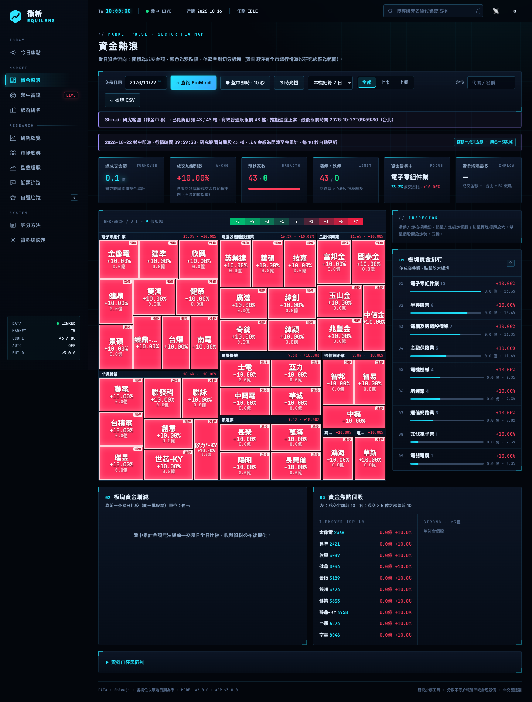
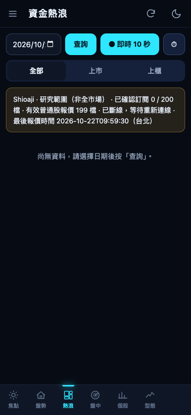

# 資金熱浪與時光機

一張圖看出當天資金流向：每個方塊是一個板塊，面積是成交金額，顏色是漲跌幅。盤中每 10 秒更新。快照來源另可每分鐘錄一個畫格，之後回放整天的變化。

## 在哪裡

- 電腦版：左側選單「資金熱浪」。
- 手機版：「熱浪」分頁。

## 怎麼看

- **板塊**：依股票清單的產業別分組；資料源沒有產業資料的市場改用你的研究族群分組。
- **面積**＝板塊（或個股）成交金額；**顏色**＝漲跌幅（紅漲綠跌，可在設定改為綠漲紅跌）。板塊漲跌幅是成份股的成交金額加權平均。
- 點板塊放大看成份股，點個股開啟走勢／K 線視窗（見[個股視窗](stock-detail.md)）。電腦版點方塊先鎖定個股，檢視器有「走勢／五檔」與（研究名單內）「個股診斷」按鈕，雙擊方塊直接開啟走勢。
- 「成交加權漲跌」是全部個股漲跌幅依成交金額加權的平均，**不是加權指數**（加權指數依市值加權）；成交集中在中小型股時兩者可能差很多。真正的加權指數與櫃買指數在手機版「盤勢」的大盤指數卡。
- 頁首統計：總成交金額與較前日變化、上漲／下跌／平盤家數、漲停／跌停家數（台股以 9.5% 判定接近漲跌停；沒有漲跌幅限制的市場不統計）。
- 可篩選上市／上櫃，並選擇過去的日期查詢。

## Shioaji 盤中研究範圍

- 即時推播來源選為 Shioaji 時，每 10 秒讀取 Nexus 推播快取。沿用現有訂閱清單（自選優先，再排研究名單，上限 200 檔），不新增連線、訂閱或永豐金快照請求。
- 只納入已訂閱普通股的當日有效報價；顯示「研究範圍（非全市場）」、已確認／計畫訂閱檔數、有效普通股報價檔數與最後報價時間（台北）。成交金額及占比只代表這個範圍。
- 未連線、75 秒無訊息、監控關閉、非盤中或尚無有效報價時，清空即時圖並顯示狀態。前日資料不冒充今日報價；連線心跳正常不代表每檔都剛成交，時間仍使用實際報價時間。
- 訂閱未全部確認或來源回報錯誤時，另顯示警示；可用的當日報價仍限於研究範圍。
- 重訂閱會立即標示斷線並清除舊連線緩衝；新連線認證不會讓舊報價變成新報價。
- 桌面與手機都顯示此狀態。選日期查詢或歷史紀錄後，尚未返回的即時回應不能覆蓋該圖。快速切換歷史日期以最後一次選擇為準；舊請求的錯誤與結束事件也不能改寫新狀態。
- 即時回應跨日才送達時，不顯示前一交易日的圖。首次載入被暫停再重啟後，仍會定時更新。
- Shioaji 熱浪圖不新增時光機錄製；既有歷史回放保留，新畫格仍需快照來源。

## 其他資料源的盤中即時熱浪

- 盤中（平日開盤到收盤後數分鐘，含收盤撮合）每 10 秒取一次全市場即時快照。
- 同一份快照同時供時光機、即時看板、異動雷達與自訂提醒使用，不會重複請求。
- 只能逐檔查詢的資料源只查研究名單與自選股（最多 300 檔），並依每分鐘額度拉長間隔。

## 時光機

- 有全市場快照來源時，盤中每分鐘記錄一個全市場畫格（每檔的價格、累計成交金額與成交量）。
- 保留最近 20 個交易日；結束的交易日會自動壓縮。
- 回放：拖動時間軸或按播放，可選播放速度；同時顯示**板塊輪動**圖（每 5 分鐘新增成交金額的板塊占比）。
- 時光機紀錄也被其他功能使用：個股 5 分 K（盤中）、族群排名收盤紀錄、五檔錄製器選股、分點追蹤的當日成交量。
- 盤中監控沒有執行的時段不會有紀錄。

## 盤後熱浪

- 每日更新（預設 19:30）時以全市場單日行情建立當日熱浪圖並保存；也可以選日期手動查詢（2015-01-05 之後）。
- 資料源沒有全市場單日行情時，改用研究名單的本機日資料組成（範圍只有研究族群）。

## 資料來源與請求量

| 項目 | 需要 | 請求量 |
|---|---|---|
| Shioaji 盤中研究範圍熱浪 | 已設定的 Shioaji 推播 | 每 10 秒讀本機快取；不增加上游請求 |
| 快照盤中熱浪、時光機 | 盤中即時快照（FinMind Sponsor、富果付費方案等） | 全市場快照每 10 秒 1 次，約每小時 360 次 |
| 盤後熱浪 | 全市場單日行情（FinMind Sponsor、證交所開放資料等） | 每個日期 2 次（當日與前一交易日） |

## 設定

「盤中雷達 → 雷達設定」的「盤中監控」開關控制盤中行情（關閉後熱浪不再即時更新、時光機不錄製）。

## 相關檔案

`EquiLens-Nexus/lib/heatmap.mjs`、`lib/replay.mjs`、`public/heatmap.js`；紀錄 `.local/heatmap-*.json`、`.local/replay/`。
