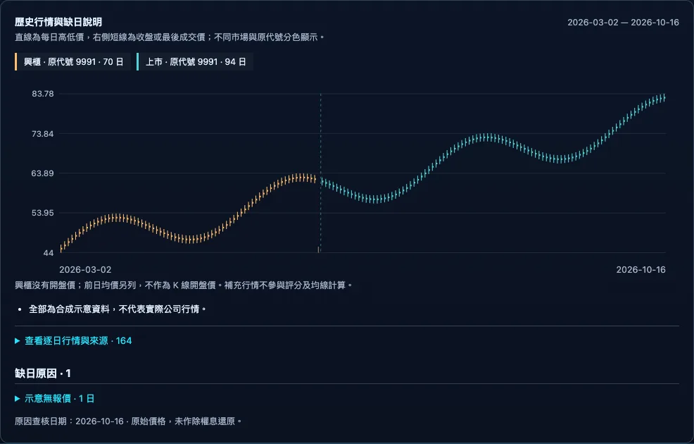
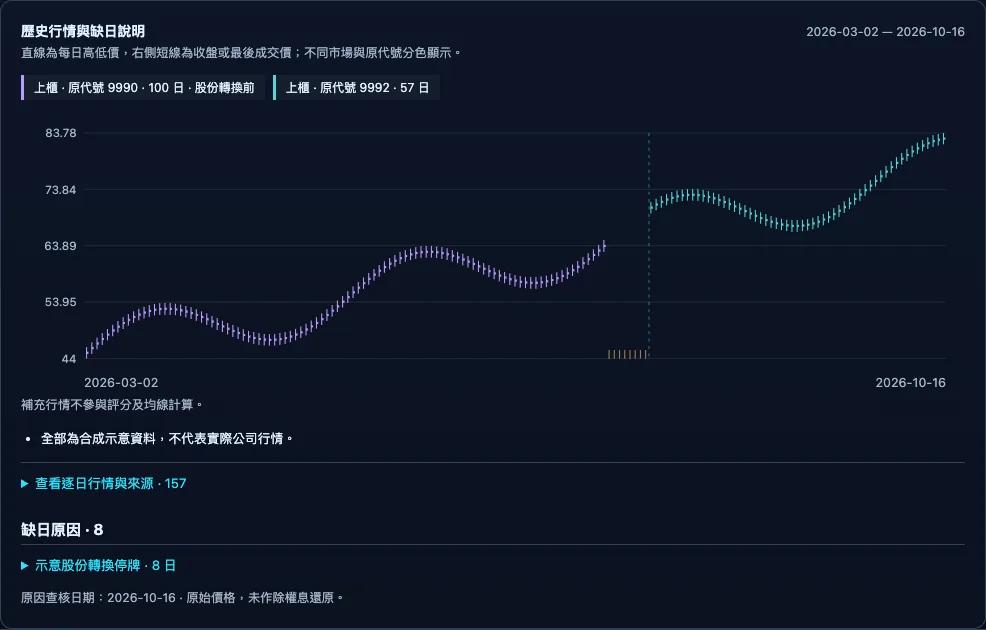
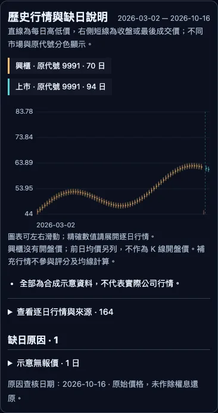

# 補充歷史行情與缺日說明

把興櫃歷史及股份轉換前的原代號行情，與目前上市櫃行情一起檢視。市場與原代號分色標示，停牌、無報價及未確認日期另列原因，不填入虛構價格。

## 在哪裡

電腦版與手機版：開啟股票視窗，進入「個股診斷」，在原有 K 線下方查看「歷史行情與缺日說明」。只有已匯入補充資料或缺日紀錄的股票會顯示。

## 內容

- 圖表以直線表示每日高低價，右側短線表示收盤或最後成交價，不跨缺日連線。
- 圖例列出市場、原代號、資料日數；股份轉換前的資料保留原代號。
- 「逐日行情與來源」可展開查閱日期、市場、原代號、開盤價、興櫃前日均價、當日均價、成交股數與來源。
- 興櫃沒有開盤價，開盤欄顯示「不適用」。前日均價獨立列出，即使超出當日高低價也不改成開盤價。
- 「缺日原因」依原因分組，展開可看實際日期及來源。價格後續已補回時，不再顯示該日期的舊缺漏註記。
- 手機可左右滑動圖表與明細表。既有日線未記錄逐日來源時，來源欄顯示「—」。
- 查核日期與涵蓋區間固定顯示；補充包以外的日期不宣稱已查核。

## 保存與匯入

原始行情仍在 `.local/stocks/`。補充檔獨立放在 `.local/history-supplements/<市場代碼>/<股票代號>.json`，不改寫任何既有行情。市場代碼例如 `TW`，與資料列的「上市／上櫃／興櫃」分開。

在 Nexus 目錄執行 `node tools/import-history.mjs bundle.json [資料目錄]`。匯入前驗證所有資料；相同補充檔重複匯入會略過，既有補充檔內容不同會拒絕覆寫。新增檔案使用不可覆寫模式建立。

補充包為陣列，每個元素有 `version: 1`、`market`、`stockId`、`from`、`to`、`calendar`、`segments`、`gaps`、`notes`。`segments` 區分 `emerging` 與 `predecessor`，各有 `market`、`originalId`、`rows`。每筆列有日期、高低與最後價、成交股數與金額；興櫃的 `previousAverage` 不轉成 `open`。無有效報價時價格欄為 `null`，並保留缺日說明。參考 [資料層](../../EquiLens-Nexus/lib/history.mjs) 與 [匯入器](../../EquiLens-Nexus/tools/import-history.mjs)。

## 資料來源與請求量

補充歷史功能只讀本機已驗證補充檔，不新增行情服務請求；個股頁其他功能維持原本行為。來源網址由補充包保存。手機版透過已登入的 Pocket API 取得同一份資料，不提供未登入讀取。

## 注意事項

這是原始價格檢視，沒有除權息還原。股份轉換保留市場與原代號，不能視為同一證券的還原日線。補充資料不加入既有技術評分、均線或型態計算。檔案不符格式或市場時顯示錯誤，既有個股行情照常使用。公司公告原因保留原始語言。

