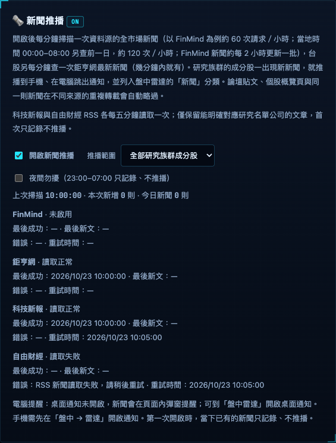

# 新聞推播

研究族群成分股的新文章會列入盤中雷達「新聞」，沿用既有手機與桌面通知設定。台股包含鉅亨網，以及科技新報、自由財經 RSS；FinMind 停用時不會因新增來源恢復。

## 在哪裡

- 電腦版「資料與設定 → 新聞推播」，或手機版 ☰（設定）→ 新聞推播。
- 新聞列表在盤中雷達「新聞」分類，點文章開啟原文。

## 來源與請求量

| 來源 | 讀取範圍 | 時程 |
|---|---|---|
| FinMind | 原全市場當日新聞；00:00–08:00 另查前日 | 原約每分鐘；憑證／quota gate 不變 |
| 鉅亨網 | 台股最新新聞清單 | 約每分鐘 |
| [科技新報](https://technews.tw/news-rss/) | 官方新聞 RSS，科技與產業 | 每來源每五分鐘，最多約 12 次／小時 |
| [自由財經](https://news.ltn.com.tw/rss/business.xml) | 自由時報官方財經 RSS | 每來源每五分鐘，最多約 12 次／小時 |

兩個 RSS 只在 TW 市場且新聞開啟時讀取，不需要 FinMind 金鑰。每來源的嘗試時間在送出前保存；失敗、合法空清單或重啟都不會提前重抓。各來源獨立執行，RSS 慢回應不會讓鉅亨等待兩個 feed。沒有抓取文章全文、LLM 配對或任意 RSS 訂閱功能。

每個 feed 逾時 20 秒、解壓後上限 1 MiB，最多處理 100 篇。拒絕 DOCTYPE／ENTITY、轉址與非來源官方網域的文章連結；無效或超前時間略過。合法空 feed 是成功；格式錯誤是失敗。官方 feed 的單次可用性不代表完整涵蓋或長期穩定。

## RSS 如何對應公司

只採本機已有的上市櫃索引與研究名單交集，不為 RSS 額外更新股票名單。

1. 明確四碼代號，例如括號代號、股票代號標示或 `.TW`／`.TWO`。1900–2099 形似年份的括號數字需有相符公司名稱在前，或明確代號標示；中鋼（2002）與中鴻（2014）可辨識，單純年份不當股票。
2. 媒體 category 與唯一公司名稱精確相同。
3. 標題／摘要出現至少三字、索引內唯一且沒有較長公司名稱衝突的名稱。

兩字名稱不做內文 substring 配對。「世界」「統一」「大同」「台灣大」「中華」等歧義詞及地名型名稱不靠名稱或 category 猜配；須有明確代號。重複公司名稱、未知上市櫃身分、研究名單之外均略過。摘要中的超連結推薦、script／style、編碼不明的 HTML 不作證據；不讀 content:encoded 全文。這些規則刻意偏向少收，可能漏掉只有暱稱、縮寫、模糊短名或沒有直接提及公司的產業文章。

只留下標題、原文連結、時間、來源與關聯股票。摘要只在記憶體配對，不存檔、不顯示全文。

## 去重與首次讀取

同連結或同標題的跨來源文章沿用既有去重；多檔股票合併成一則。新加入的 RSS／鉅亨來源第一次有相關文章只記錄、不推播，五分鐘後的新文章正常處理。空清單不提前解除首次保護；重啟保留來源基準。全域停用／無成功掃描超過十分鐘後，仍先只記錄現有文章。首次／恢復判斷在每批請求開始時固定，慢來源跨到下一輪才回覆也保留原判斷；空來源先成功不會解除其他在途來源的保護。持續正常輪詢的來源不因此停止新文提醒。

市場、新聞設定或研究範圍變更後，舊請求結果不能更新健康狀態、去重或提醒。跳過尚未到期來源不會改最後成功或錯誤。

## 來源狀態

兩版設定頁列出 FinMind、鉅亨網、科技新報、自由財經。

| 欄位 | 定義 |
|---|---|
| 最後成功 | 真正成功取得並解析 feed 的時間；合法空資料也算成功 |
| 最後新文 | 該來源最近找到研究範圍內、去重後的新文章；首次 seed 不計入，不受只推自選股限制 |
| 錯誤 | 該來源自己成功後才清除，不由其他來源覆蓋 |
| 重試時間 | RSS 顯示五分鐘後可再讀取時間；既有 FinMind／鉅亨暫停規則保持 |

狀態存在 `.local/news-seen.json.health`，去重鍵與已見來源仍保留。所有來源都失敗時不推進全域去重時間。首頁「今日焦點」與個股診斷的歷史新聞取得方式沒有改動。

## 設定與通知

新聞預設關閉，可選研究名單全部或只推自選股；夜間勿擾為 23:00–07:00 只記錄、不推播。手機既有小量逐則／大量摘要規則、桌面通知／頁面彈窗規則不變。加入 RSS 不會自動開啟通知或啟動 Pocket。

## 相關檔案

`lib/providers/rss-news.mjs`、`lib/news-poll.mjs`、`lib/newswatch.mjs`、`lib/news-health.mjs`、兩版 `public/news-source.js` 與 Nexus `server.mjs`。

