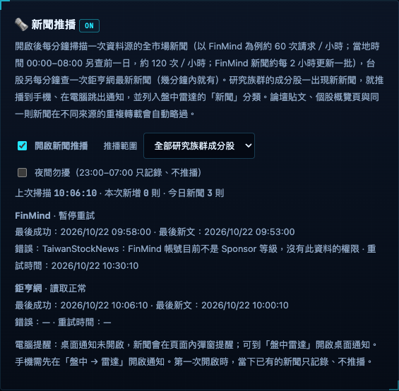

# 新聞推播

研究族群的成份股一出現新新聞，就推播到手機、在電腦跳出通知，並列入盤中雷達的「新聞」分類。

## 在哪裡

- 開關與設定：電腦版「資料與設定 → 新聞推播」，或手機版左上角 ☰（設定）→ 新聞推播。
- 新聞列表：電腦版與手機版的盤中雷達「新聞」分類；點新聞直接開啟原文。

## 運作方式

- 每分鐘掃描一次：
  - 資料源的全市場當日新聞（例如 FinMind 新聞，約每 2 小時更新一批）；台北時間 00:00–08:00 另查前一日（部分來源以 UTC 標示日期）。
  - 台股另加鉅亨網最新新聞（幾分鐘內就有）。
- 只推研究名單成份股「第一次出現」的新聞：以是否看過判斷，不依時間判斷新舊。
- 同一篇新聞在不同來源或不同網址轉載時只推一次；論壇貼文、個股概覽與報價頁會略過。
- 一則新聞提到多檔股票時合併成一則，標示「某某等 N 檔」。
- 第一次開啟時，當下已有的新聞只記錄、不推播；之後新增的鉅亨網來源第一次也只記錄。

## 來源狀態

兩版的新聞推播設定分別列出 FinMind、鉅亨網：

| 欄位 | 定義 |
|---|---|
| 最後成功 | 該來源最近一次成功讀取的時間；空清單也算成功 |
| 最後新文 | 該來源最近一次找到研究範圍內、去重後新文章的時間；首次只記錄不計入，不受「只推自選股」篩選影響 |
| 錯誤 | 保留該來源最近錯誤，直到它自己讀取成功；另一個來源成功不會清掉 |
| 重試時間 | 權限、額度或金鑰錯誤暫停 30 分鐘；其他失敗顯示下輪掃描的預計時間（約 60 秒） |

成功掃描但沒有新文會保留原本的「最後新文」。首次升級沒有來源紀錄時顯示「—」，不推定以前的成功時間。狀態存於 `news-seen.json.health`，原有去重鍵與新聞事件保留。兩個來源都不可用時不推進去重掃描時間，恢復後仍沿用超過 10 分鐘只記錄的保護。

首頁「今日焦點」仍使用固定盤前區間；個股診斷的已存新聞仍由原取得流程更新。這次沒有改寫兩者的歷史內容。

## 設定

| 設定 | 選項 |
|---|---|
| 開啟新聞推播 | 預設關閉 |
| 推播範圍 | 全部研究族群成份股／只推自選股 |
| 夜間勿擾 | 23:00–07:00 只記錄、不推播 |

## 通知方式

- 手機：一次 4 則以內各自推播，點開看原文；更多時合併成一則摘要。
- 電腦：開啟桌面通知時以桌面通知顯示；未開啟時在頁面內彈窗。

## 請求量

FinMind 約每小時 60 次（00:00–08:00 約 120 次）；鉅亨網每分鐘 1 次。額度用完或金鑰失效時暫停 30 分鐘。

## 相關檔案

`EquiLens-Nexus/lib/newswatch.mjs`、`lib/news-health.mjs`、`public/news-source.js`、`lib/providers/cnyes.mjs`；看過的新聞 `.local/news-seen.json`。

## 來源狀態示意

